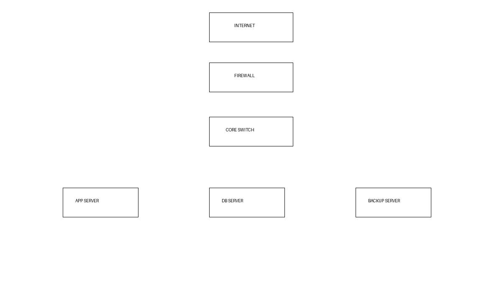

# Enterprise Application Infrastructure (Java 21 / Spring Boot) - lab

Reference scripts and documents for preparing Linux servers to host Java-based enterprise systems across development, testing, production and disaster-recovery environments. These are lab examples (no client data or credentials); test before use.

| Folder | Content |
|---|---|
| `linux-setup/` | `install_java21.sh` (idempotent), `create_app_user.sh` (least-privilege service account) |
| `middleware/` | `install_nginx.sh`, `nginx-reverse-proxy.conf` (TLS, security headers, proxy to Spring Boot) |
| `deployment/` | `docker_install.sh` (official repo), `docker-compose.yml`, `myapp.service` (systemd) |
| `documentation/` | `server-hardening.md` (12 controls with verification), `environments-and-dr.md` |

Related: backup, monitoring and recovery scripts are in the `tools` repository; networking is in `network`.
